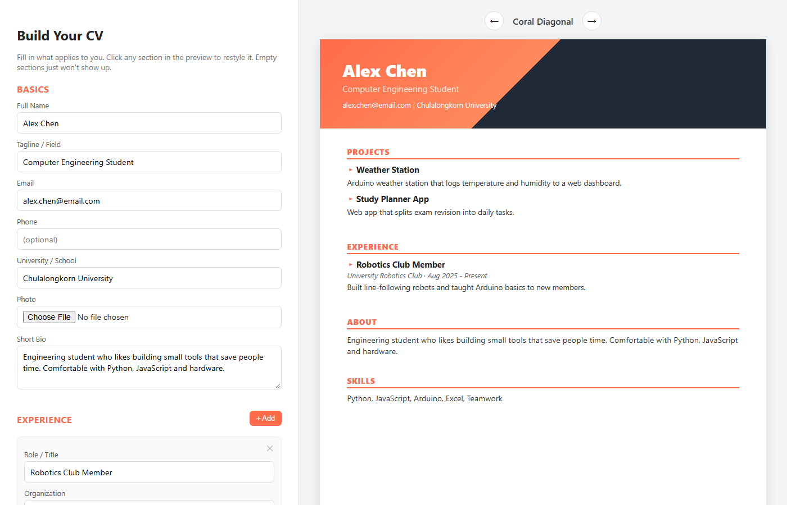

# CV Generator

**Build a good-looking CV in your browser: fill in a form, watch the CV update live, download it as a PDF.**

Example with made-up details.

## Try it

1. Open **[the CV Generator](https://axm12345.github.io/cv-generator/)**.
2. Type your name, a tagline and a short bio. The CV on the right updates as you type.
3. Click **+ Add** under Experience or Projects to add entries.
4. Use the **← →** arrows above the CV to switch between the 4 templates.
5. Click any section of the CV to change its font, size or colour, or move it up or down.
6. Click **Download as PDF**.

## Features

- **Live preview.** No "generate" button. What you type shows up immediately.
- **4 templates:** Coral Diagonal, Minimal Mono, Ocean Blue and Forest Sidebar.
- **Restyle any section** by clicking it: font, size, colour and order.
- **Optional photo** and background colour.
- **Empty sections hide themselves**, so the CV never shows blank headings.
- **PDF export** with html2canvas and jsPDF.
- **Private by design.** Everything runs in your browser. No server, no account, and your details never leave your computer.

## Tech

HTML · CSS · JavaScript (no framework) · html2canvas · jsPDF

## Run it yourself

Download the repo and open `index.html` in any browser. There's nothing to install.
